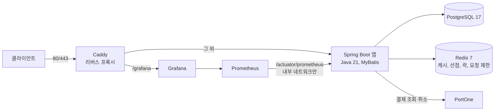
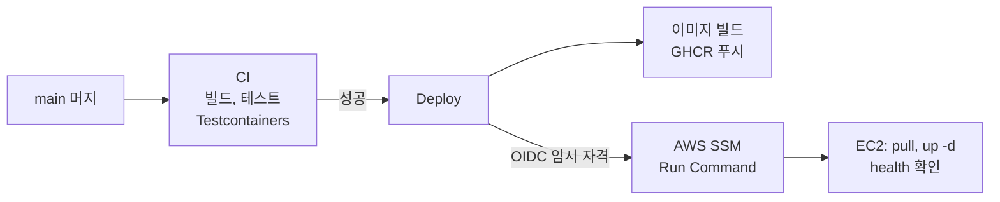
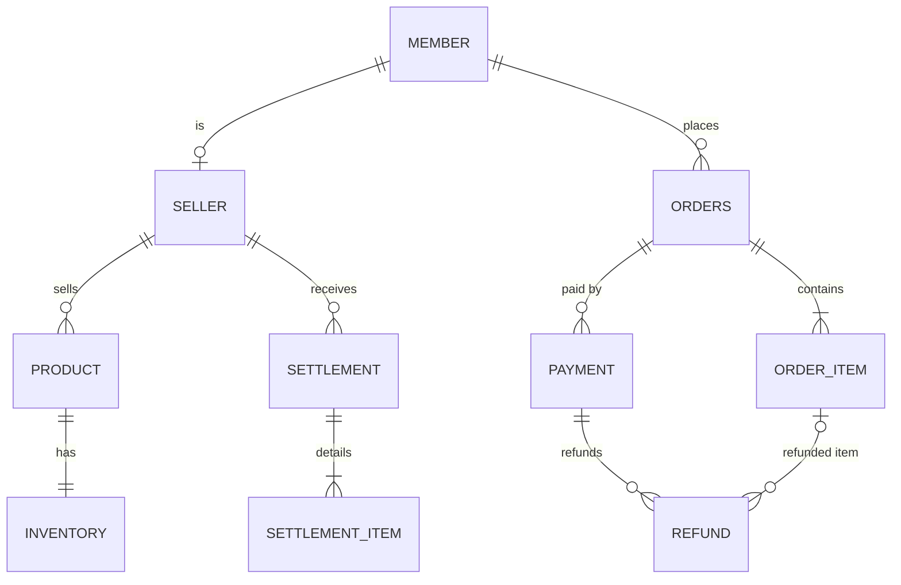

# market-settlement


소규모 마켓플레이스의 **주문·결제·환불·판매자 정산** 백엔드. 기획부터 배포·모니터링·부하 측정까지 혼자 만든 1인 프로젝트다.

> 상태: 백엔드, 배포(자동), 모니터링, 성능 측정까지 구현. React 화면은 아직 없다(보완 계획은 [GitHub Issues](https://github.com/sihwan0802/market-settlement/issues) 참고).

## 해결하려는 문제
엑셀과 수작업으로 정산하던 소규모 마켓에서 생기는 문제([AS-IS](docs/AS-IS.md))를 코드로 푼다.

| 문제 | 해결 |
| --- | --- |
| 정산 금액 불일치 | 정산 명세를 원천 건(주문 항목, 환불) 단위로 저장, 유니크 제약으로 중복 방지 |
| 환불 시점 불일치 | 확정된 정산은 고치지 않고 **환불이 일어난 날**의 정산에서 차감 |
| 수수료 차이 | 판매자별 수수료율을 정산 시점 값으로 고정 저장 |
| 초과 판매 | Redis 재고 선점 + DB 조건부 UPDATE, 1,000건 동시 요청에서 초과 판매 0건 |
| 월말에 몰아서 대조 | 일 정산 배치와 정합성 검증 쿼리 (`결제 − 환불 = 정산 net + 수수료`) |

## 핵심 설계
- **일 정산 배치**: 매일 01:00(KST) 전날 결제 완료 매출 − 환불을 판매자별 트랜잭션으로 정산. `(판매자, 날짜)` 유니크와 `ON CONFLICT DO NOTHING`이라 재실행해도 결과가 같고, Redis 락으로 같은 날짜의 동시 실행을 막는다.
- **결제**: PortOne 결제를 서버에서 다시 조회해 금액·통화를 주문과 대조. 외부 호출은 DB 트랜잭션 밖에서 하고, 같은 결제 번호를 다시 보내도 중복 처리하지 않는다. 만료된 주문에 늦게 온 결제는 자동 취소.
- **환불**: 실패하지 않은 환불은 주문 항목당 하나만 허용(부분 유니크 인덱스, 주문 행 잠금). 외부 응답이 불확실해 `REQUESTED`로 남은 건은 배치가 PortOne 상태를 보고 복구.
- **선착순 구매**: Redis Lua 스크립트로 재고 확인과 차감을 한 번에 하고 DB에서 확정. 재고 부족 요청은 DB에 닿지 않는다. Redis가 죽으면 DB로 폴백.
- **인증**: stateless JWT, BCrypt, 구매자/판매자/관리자 권한 분리. 주문·로그인 요청 제한(Redis).
- 설계 결정과 이유는 [ERD와 도메인 결정](docs/ERD.md)에 있다.

## 성능 (한 대 PC, 같은 시나리오 전후 비교)
| 시나리오 | 지표 | 개선 전 | 개선 후 | 한 일 |
| --- | --- | --- | --- | --- |
| 상품 조회 | 응답 p95 | 18.0ms | 11.4ms | Redis 캐시 |
| 선착순 구매 (1,000건) | DB 트랜잭션 수 | 857~1,416 | 76~78 | Redis 재고 선점 |
| 정산 정합성 검증 | 시간 | 101초 | 0.18초 | 쿼리 구조 개선 |
| 정산 (판매자 100명, 하루) | 시간 | 1.8초 | 1.13초 | 인덱스, 일괄 조회 |

초과 판매는 전후 모두 0건이고 정산 결과는 전후 해시가 같다. 측정 환경, 재현 방법, 효과가 작았던 항목과 한계는 [성능 측정](docs/performance.md).

## 아키텍처

`/actuator/prometheus`는 Caddy가 밖에서 404로 막고 Prometheus만 내부로 읽는다. 구성 전체가 AWS EC2 한 대(t3.small)에서 Docker Compose로 돈다.

## 배포 흐름

SSH 포트도 저장된 서버 키도 없이, GitHub OIDC로 받은 몇 분짜리 자격과 SSM으로 배포한다. 자세한 설정과 막혔던 곳은 [배포](docs/deploy.md).

## ERD

컬럼까지 있는 전체 ERD와 상태값은 [docs/ERD.md](docs/ERD.md).

## 기술 스택
| 영역 | 선택 |
| --- | --- |
| Backend | Java 21, Spring Boot 4, MyBatis, Flyway |
| DB / Cache | PostgreSQL 17, Redis 7 |
| 결제 | PortOne (테스트 모드) |
| Infra | Docker, GitHub Actions, AWS EC2, Caddy, GHCR, SSM |
| 모니터링 | Prometheus, Grafana (요청, 응답 시간, JVM, 커넥션 풀, 정산 소요) |
| 테스트 / 부하 | JUnit, Testcontainers, k6 |

## API 개요
| 영역 | 엔드포인트 |
| --- | --- |
| 인증·회원 | `POST /api/auth/signup`, `POST /api/auth/login`, `GET /api/me`, `PUT /api/me/password`, `POST /api/me/withdraw` |
| 상품 (판매자 쓰기, 조회는 공개) | `POST /api/products`, `GET /api/products`, `GET /api/products/{id}`, `PUT`, `DELETE` |
| 주문 (구매자) | `POST /api/orders`, `GET /api/orders`, `GET /api/orders/{id}`, 판매자 주문 `GET /api/seller/orders` |
| 결제·환불 | `POST /api/orders/{orderId}/payments`, `POST /api/orders/{orderId}/refunds` |
| 정산 (관리자) | `POST /api/admin/settlements`, `GET /api/admin/settlements/missing`, `GET /api/admin/settlements/inconsistent` |

## 실행 방법
필요한 것: Docker (앱 실행은 JDK 없이 가능), 테스트는 JDK 21과 Docker.

```bash
docker compose up --build        # 앱, PostgreSQL, Redis
curl localhost:8080/actuator/health
```

결제 확인에는 PortOne 테스트 API 시크릿이 필요하다. `.env.example`을 `.env`로 복사해 `PORTONE_API_SECRET`을 채운다(없어도 가입, 상품, 주문 생성·조회까지는 동작). `JWT_SECRET`을 비우면 개발용 기본값을 쓴다.

```bash
# 가입과 로그인
curl -X POST localhost:8080/api/auth/signup -H 'Content-Type: application/json' \
  -d '{"email":"seller@test.com","password":"password123","name":"seller","role":"SELLER","storeName":"store"}'
curl -X POST localhost:8080/api/auth/login -H 'Content-Type: application/json' \
  -d '{"email":"seller@test.com","password":"password123"}'      # accessToken을 `Authorization: Bearer` 헤더로 사용
```

```bash
cd backend && ./gradlew test     # Testcontainers가 PostgreSQL, Redis를 띄운다 (Docker 필요)
```

부하 측정(시드 데이터, k6 시나리오)은 [docs/performance.md](docs/performance.md)의 "재현 방법", 서버 배포는 [docs/deploy.md](docs/deploy.md).

## 문서
- [AS-IS 분석](docs/AS-IS.md), [TO-BE](docs/TO-BE.md), [PRD](docs/PRD.md)
- [ERD와 도메인 결정](docs/ERD.md)
- [성능 측정](docs/performance.md)
- [배포와 모니터링](docs/deploy.md)
- [이슈 목록 초안](docs/issues.md)

## 진행
| 주차 | 목표 | 상태 |
| --- | --- | --- |
| 1 | 도메인·ERD·핵심 API·Docker Compose | 완료 |
| 2 | 결제·환불·정산 배치·시드 데이터·k6 측정·Redis | 완료 |
| 3 | AWS 배포·CI/CD·모니터링·전후 측정·문서 | 완료 (React 화면은 미구현) |
| 4 | 보완: 결제·정산 안정성, 보안, Redis, 조회 개선 | 진행 중 ([M4 이슈](https://github.com/sihwan0802/market-settlement/milestone/5)) |
