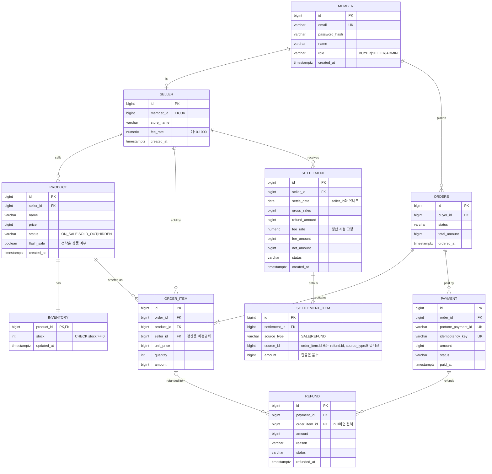

# ERD와 도메인 결정

## 확정한 설계 결정
| 항목 | 결정 | 이유 |
| --- | --- | --- |
| 정산 주기 | **일 정산**: 전일 00:00~24:00 결제 완료 매출 − 환불 | 배치 반복 측정이 쉽고 성능 테스트 데이터가 빨리 쌓임 |
| 수수료 | 판매자별 `fee_rate` (기본 10%), 정산 시점 값을 정산 행에 고정 저장 | 수수료율이 바뀌어도 과거 정산이 변하지 않게 |
| 금액 | 원 단위 정수 `BIGINT` | 부동소수점 오차 방지 |
| 환불 | 부분 환불 가능(주문 항목 단위), 환불은 **환불이 일어난 날**의 정산에서 차감 | 이미 정산한 날의 금액을 수정하지 않음 |
| 정산 멱등성 | `settlement(seller_id, settle_date)` 유니크, `settlement_item`의 원천 건 유니크 | 배치를 재실행해도 중복 정산이 없게 |
| 재고 | `inventory` 테이블 분리, `stock >= 0` 체크 | 재고 갱신 경합을 상품 조회와 분리 |
| 선착순 구매 | Redis에서 선점 후 DB 재고 확정 (M2에서 구현) | 초과 판매 0건, DB 부하 감소 |

## 상태값
- 주문 `orders.status`: `CREATED` → `PAID` → `CANCELED` / `REFUNDED`(전액) / `PARTIAL_REFUNDED`
- 결제 `payment.status`: `READY` → `PAID` / `FAILED` / `CANCELED`
- 환불 `refund.status`: `REQUESTED` → `COMPLETED` / `FAILED`
- 정산 `settlement.status`: `PENDING` → `APPROVED`(운영자) → `PAID`

## ER 다이어그램


## 정산 계산식
```
gross_sales   = Σ 전일 PAID 주문의 order_item.amount (해당 판매자)
refund_amount = Σ 전일 COMPLETED 환불 금액 (해당 판매자의 항목)
fee_amount    = floor((gross_sales − refund_amount) × fee_rate)
net_amount    = gross_sales − refund_amount − fee_amount
```

### 정합성 검증 (M2 테스트에서 사용)
전체 기간에 대해 아래가 항상 성립해야 한다.
```
Σ 결제 완료 금액 − Σ 환불 금액 = Σ settlement.net_amount + Σ settlement.fee_amount
```
(정산 대기·미실행 일자는 제외하고 계산)

## 인덱스 (초안)
- `orders(buyer_id, ordered_at)`
- `order_item(seller_id, order_id)`
- `payment(order_id)`, `payment.portone_payment_id` 유니크, `payment.idempotency_key` 유니크
- `refund(payment_id)`, `refund(refunded_at)`
- `settlement(seller_id, settle_date)` 유니크
- `settlement_item(source_type, source_id)` 유니크
- 정산 배치 조회용 `payment(paid_at)`

## 열어 둔 질문
- 구매확정 단계를 둘지 (지금은 결제 완료 시점에 매출 인식)
- 환불 시 재고 복구 정책
- 한 주문에 여러 판매자 상품을 허용하는 것은 `order_item.seller_id`로 이미 지원
