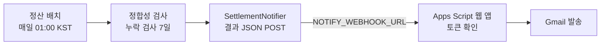

# 정산 알림 자동화 (Apps Script)

매일 01:00 정산이 끝나면 결과를 메일로 받는다. 정산 완료만이 아니라 정합성 오류와 누락 검사 결과도 같은 메일에 담는다. 이상이 있으면 제목이 `[정산 확인 필요]`로 바뀌어 로그를 보지 않아도 알 수 있다.

- 앱은 `NOTIFY_WEBHOOK_URL`이 비어 있으면 아무것도 보내지 않는다. 전송이 실패해도 정산에는 영향이 없고 경고 로그만 남는다(타임아웃 10초)
- 보내는 내용: `type`, `date`, `created`, `skipped`(다른 서버가 실행 중이라 건너뜀), `inconsistentIds`, `missing`, `ok`
- 관리자가 `POST /api/admin/settlements/daily?date=YYYY-MM-DD`로 같은 작업을 바로 실행할 수 있다. 알림을 시험할 때 쓴다

## 설정 (한 번만)
1. [script.google.com](https://script.google.com)에서 새 프로젝트를 만들고 `docs/apps-script/settlement-notify.gs` 내용을 붙여 넣는다
2. 프로젝트 설정 → 스크립트 속성에 `TOKEN`(임의의 긴 문자열)과 `MAIL_TO`(받을 메일 주소)를 추가한다
3. 배포 → 새 배포 → 유형 웹 앱, 실행 사용자 "나", 액세스 권한 "모든 사용자"로 배포하고 권한을 승인한다. 나온 웹 앱 URL 끝에 `?token=<TOKEN 값>`을 붙인 것이 알림 주소다
4. 서버 `~/market/.env`에 `NOTIFY_WEBHOOK_URL=<알림 주소>`를 넣고 `docker compose up -d app`으로 다시 띄운다
5. 관리자 토큰으로 `POST /api/admin/settlements/daily?date=<어제>`를 호출해 메일이 오는지 확인한다

주소에 토큰이 들어 있으므로 `.env`에만 두고 깃이나 채팅에 올리지 않는다.

## 한계
- 웹 앱 주소를 아는 사람은 누구나 호출할 수 있어서 토큰이 유일한 방어선이다(Apps Script는 요청 헤더를 읽지 못해 서명 검증을 못 한다). 노출되면 `TOKEN`만 바꾸고 주소를 갱신한다
- 메일 발송이 실패하거나 앱이 보낸 요청이 유실돼도 재시도하지 않는다. 정산 자체는 일 배치와 누락 검사로 따로 보호된다
- 하루 메일 한도(무료 계정 100통)가 있지만 하루 한 통이라 문제없다
- 판매자별 정산 완료 알림은 하지 않는다(판매자 메일 정책이 필요해 M4 이후)
